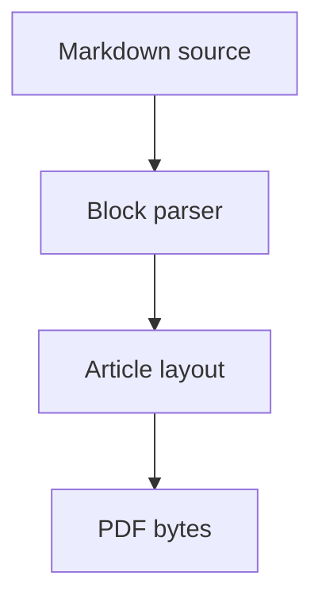

# Portable Mermaid flowchart subset

Date: 2026-06-01

## Scope

This note documents the first Mermaid support in the portable MarkdownPDF
renderer. The implementation is pure Swift and emits direct PDF drawing and text
operators. It applies to macOS and Linux because it does not use Apple-only APIs.
It does not claim iOS support.

No Node, JavaScript, browser renderer, shell renderer, PDFKit, CoreGraphics,
WebKit, LaTeX, C renderer, or external PDF library is involved.

## Supported syntax

The first subset supports Mermaid flowcharts with one statement per line:

Supported graph headers:

- `flowchart TD`
- `flowchart TB`
- `flowchart BT`
- `flowchart LR`
- `flowchart RL`
- `graph` with the same directions

Omitting the direction defaults to top-bottom layout.

Supported node syntax:

- Bare node identifiers: `A`
- Rectangle labels: `A[Label]`
- Quoted rectangle labels: `A["Longer label"]`

Supported edge syntax:

- Solid directed edge: `A --> B`
- Solid directed edge with label: `A -->|label| B`
- Dashed directed edge, with or without a label: `A -.-> B`, `A -.->|label| B`
- A chain on one line, one edge for each neighbouring pair, each with its own label
  and line style: `A --> B -.->|x| C --> D`. An arrow inside a quoted label or inside
  brackets is label text, not an edge.
- Plain link without an arrowhead, `A --- B` or `A ---|label| B`, longer forms such as
  `A ----- B`, and its dotted form `A -.- B`. A longer arrow `A ---> B` is an arrow.
  Two dashes alone, as in `a--b`, are text. Ids written without spaces, `a---b`, are a
  link, as Mermaid reads them.
- Invisible link `A ~~~ B`, which only influences the layout and draws nothing. It
  takes no label.

Supported grouping syntax:

- A `subgraph` block: `subgraph id`, `subgraph id[Title]` or `subgraph id["Title"]`, the
  nodes written inside it, and `end`. The title takes line breaks like a node label.
- `direction TD`, `TB`, `BT`, `LR` or `RL` inside a subgraph sets how its own nodes are
  laid out. Without one the group takes the diagram's direction. The group's direction
  is always honoured, where Mermaid ignores it for a group whose nodes link to nodes
  outside it.
- A node belongs to the group it is first written inside. A link may name a node inside a
  group, a node outside, or a group, which it then joins at the group's frame. A group
  id may be named in a link before its `subgraph` line.
- The groups and the nodes outside them are layered as one diagram, each group as a
  single item; a group is then laid out inside its own frame. Subgraphs do not nest, a
  node may not be written inside two groups, and a group needs at least one node.

Labels may hold the HTML line break ` `, ` ` or ` ` (any case). In a node
label it starts a new line, and each line is wrapped to the node width on its own. In
an edge label it is a space.

Node identifiers may contain letters, numbers, underscores, and hyphens. The
renderer records nodes in first-seen order, assigns deterministic graph layers,
and places nodes using deterministic spacing.

## Unsupported syntax

Unsupported Mermaid syntax is rendered as a visible code-block fallback with a
prefix that starts `Unsupported Mermaid diagram:`. This is deliberate. The
renderer must not pretend to support the full Mermaid language and must not call
out to platform-specific or external renderers.

Examples of unsupported syntax in the first subset:

- `sequenceDiagram`
- class diagrams, state diagrams, ER diagrams, Gantt charts, and mind maps
- Styled nodes, classes, themes, shapes other than rectangles, and HTML labels other
  than the line break
- Nested subgraphs
- Thick links such as `==>` or `===`, and link text written inside the line, as in
  `A -- text --> B`
- Mermaid chart syntax outside the supported pie profile

## Validation

The implementation is validated through:

- Unit tests for supported parsing, graph aliases, quoted labels, edge labels,
  unsupported syntax, and unsupported chart syntax.
- Renderer tests that check supported Mermaid labels are emitted as PDF text and
  the raw Mermaid source is not rendered for supported diagrams.
- Fallback tests that check unsupported syntax remains visible in extracted
  text, including edge labels that cannot be placed without colliding with a
  node.
- Fixture validation using the scientific article fixture.
- Poppler word-box and MuPDF character-quad visual layout tests, now including
  edge-labeled Mermaid diagrams and native Mermaid pie charts, to catch label
  overlap.

## Edge label placement

Edge labels are not drawn opportunistically. During diagram planning, the
renderer measures the label background box and checks it against the diagram
content area and every planned node box. If the label would leave the content
area or collide with a node, the diagram falls back visibly instead of emitting
overlapping text.

This rule is portable across macOS and Linux because it uses the same base-font
measurement tables that drive normal text layout. It does not use CoreGraphics,
CoreText, SVG conversion, or browser measurement.

## Chart policy

Portable flowchart rendering remains a strict Mermaid subset. Mermaid pie charts
are now routed to the native chart renderer, which emits typed PDF drawing
operators in Swift. Other Mermaid chart syntaxes remain visible fallback text
until they have the same structural, text, geometry, and raster witnesses.

## Platform note

This feature is portable macOS/Linux Swift. It is not macOS-only. It does not
use CoreGraphics or CoreText. It does not establish iOS support.
